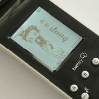

# Main Page

**Willkommen zum Wiki von Bettyhacks.com**

<table data-border="1">
<colgroup>
<col style="width: 100%" />
</colgroup>
<tbody>
<tr>
<td>
<em>Wer hier mitwirken möchte schreibt bitte an <a href="mailto:G.Henne@combio.de">G.Henne@combio.de</a> um ein Login zu bekommen. Autoregistrierung wird nicht angeboten, um das Wiki vor Verspammung zu schützen.</em>

<em>Das Hochladen von Informationen ins Wiki ist sehr erwünscht. Es gibt viele tote Links auf Ressourcen, die der eine oder andere noch archiviert hat, das wäre schön, wenn die hier bereit gestellt würden. Auch Inhalte aus dem Forum sollten hierhin, ins Wiki, übertragen werden, da es unklar ist, wie lange das Forum noch existieren wird. Wer weiss wie man das BettyHacks Forum sichern kann, kann sich auch gerne unter dieser Email melden.</em>
</td>
</tr>
</tbody>
</table>

Das Bettyhacks-Projekt wurde im Juli 2007 ins Leben gerufen, um eine alternative Firmware ([Boop](pages/Boop.md "Boop")) für die "Interaktive Fernbedienung Betty" zu entwickeln. Der ursprüngliche Verwendungszweck der Fernbedienung wurde im November 2007 endgültig eingestellt, nachdem die Verbreitung (und der daraus resultierende Nutzen) offensichtlich nicht den Erwartungen der Vertreiber entsprach.

Bis Mitte Januar 2008 waren die Server der Betreiber trotzallem noch für die Bettys erreichbar, in dieser Zeit wurde den Kunden ein endgültiges Update "beschert" - welches die Fernbedienung in eine "Universelle" für vier Geräte "verwandelt" hat - und sie damit immerhin vor dem Mülleimer bewahrt hat.

Trotzallem ist Betty für ein paar Euro bei z.B. eBay zu erstehen und lässt sich in ein durchaus sinnvolles Leben zurück erwecken.

Sie basiert auf einem ARM7tdmi Prozessor, hat 2MB Flash-Speicher, ein 160 x 128 Pixel Graustufen LCD und vieles mehr... :)

Alles in allem eine wunderbare Plattform für wenig Geld für die unterschiedlichsten Verwendungszwecke. Aber seht selbst.... \<br\\ Hier finden Sie Infomation über die Betty-Fernbedienung und die zugehörige Hard- und Software.

Besuchen Sie auch das [Gesamtforum](forum/index.md) und den [Chat](pages/Chat.md "Chat")

<table data-cellpadding="10">
<colgroup>
<col style="width: 33%" />
<col style="width: 33%" />
<col style="width: 33%" />
</colgroup>
<tbody>
<tr>
<td data-valign="top" width="30%"><h2 id="Hardware">Hardware</h2>
<ul>
<li><a href="pages/Betty.md" title="Betty">Betty</a>
<ul>
<li><a href="pages/Betty%20Hardware.md" title="Betty Hardware">Betty Hardware</a></li>
<li><a href="pages/LPC2220%20Pin-Belegung.md" title="LPC2220 Pin-Belegung">LPC2220_Pin-Belegung</a></li>
<li><a href="pages/Betty%20Buttons.md" title="Betty Buttons">Betty Buttons</a></li>
<li><a href="pages/Smartcardchip.md" title="Smartcardchip">Smartcardchip</a></li>
</ul></li>
<li><a href="pages/IP%20Adapter.md" title="IP Adapter">IP Adapter</a>
<ul>
<li><a href="pages/IP%20Adapter%20Hardware.md" title="IP Adapter Hardware">IP Adapter Hardware</a></li>
</ul></li>
<li><a href="pages/SCART%20Adapter.md" title="SCART Adapter">SCART Adapter</a>
<ul>
<li><a href="pages/SCART%20Adapter%20Hardware.md" title="SCART Adapter Hardware">SCART Adapter Hardware</a></li>
<li><a href="pages/P89LPC931%20Pin-Belegung.md" title="P89LPC931 Pin-Belegung">P89LPC931 Pin-Belegung</a></li>
</ul></li>
<li><a href="pages/TAE%20Adapter.md" title="TAE Adapter">TAE Adapter</a>
<ul>
<li><a href="pages/TAE%20Adapter%20Hardware.md" title="TAE Adapter Hardware">TAE Adapter Hardware</a></li>
<li><a href="pages/MSP430%20Pin-Belegung.md" title="MSP430 Pin-Belegung">MSP430 Pin-Belegung</a></li>
</ul></li>
<li><a href="pages/Ladestation.md" title="Ladestation">Ladestation</a></li>
</ul>
<h2 id="Bilder">Bilder</h2>
<ul>
<li><a href="pages/Pictures.md" title="Pictures">Betty HHU</a></li>
<li><a href="pages/Pictures.md" title="Pictures">SCART Adapter</a></li>
<li><a href="pages/Pictures.md" title="Pictures">TAE Adapter</a></li>
</ul></td>
<td data-valign="top" width="30%"><h2 id="Firmware">Firmware</h2>
<ul>
<li>Betty: <a href="pages/Boop.md" title="Boop">Boop</a> (<a href="pages/Original%20Firmware.md" title="Original Firmware">Original Firmware</a>)</li>
<li>SCART-Adapter: <a href="pages/Betty%20scart.md" title="Betty scart">betty_scart</a></li>
<li>TAE-Adapter: <a href="pages/Betty%20TAE.md" title="Betty TAE">betty_TAE</a></li>
<li>IP-Adapter:</li>
</ul>
<ul>
<li><a href="pages/Projekte.md" title="Projekte">Projekte</a> und Projektideen</li>
</ul>
<h2 id="Firmware_-_Entwicklung">Firmware - Entwicklung</h2>
<ul>
<li><a href="pages/Entwicklungsumgebungen.md" title="Entwicklungsumgebungen">Entwicklungsumgebungen</a></li>
<li><a href="pages/SVN.md" title="SVN">SVN</a></li>
</ul>
<h2 id="Firmware_-_Übertragung">Firmware - Übertragung</h2>

So kommt Boop in die Betty

<ul>
<li><a href="pages/Firmware%20flashen.md" title="Firmware flashen">Firmware flashen</a>
<ul>
<li><a href="pages/Tools.md" title="Tools">Tools</a> - Programme zur Übertragung</li>
<li><a href="pages/Interfaces%20PC%20zu%20Betty.md" title="Interfaces PC zu Betty">Interfaces PC zu Betty</a> - Hardware zur Übertragung</li>
</ul></li>
</ul>

 

</td>
<td data-valign="top" width="30%"><h2 id="Links_&amp;_Infos">Links &amp; Infos</h2>
<ul>
<li>Betty
<ul>
<li><a href="http://www.betty-tv.de">Offizielle Website von BettyTV</a></li>
<li><a href="http://www.itsd.de/de/Unternehmen/Referenzen/Betty-TV">BettyTV-IT-Provider</a></li>
</ul></li>
</ul>
<ul>
<li>Elektronik
<ul>
<li><a href="http://www.mikrocontroller.net/articles/ARM">Einführung zum ARM</a></li>
<li><a href="http://www.mikrocontroller.net/articles/Spezial:Allpages">Artikel rund um Elektronik und Mikrocontroller</a></li>
<li><a href="http://www.mikrocontroller.net/articles/Standardbauelemente">Standard-Bauelemente</a></li>
</ul></li>
</ul>
<h2 id="Modifikationen_&amp;_Reparaturanleitungen">Modifikationen &amp; Reparaturanleitungen</h2>
<ul>
<li><a href="pages/Umbau%20auf%20LiIon%20Akku.md" title="Umbau auf LiIon Akku">Umbau auf LiIon Akku</a></li>
<li><a href="pages/Reparaturanleitungen.md" title="Reparaturanleitungen">Reparaturanleitungen</a></li>
<li><a href="pages/Int.%20USB%20und%20Laderegler.md" title="Int. USB und Laderegler">Int. USB und Laderegler</a></li>
</ul></td>
</tr>
</tbody>
</table>

---

[Seitenindex](index.md) · [Kategorien](categories.md) · [Gesamtforum](forum/index.md)
