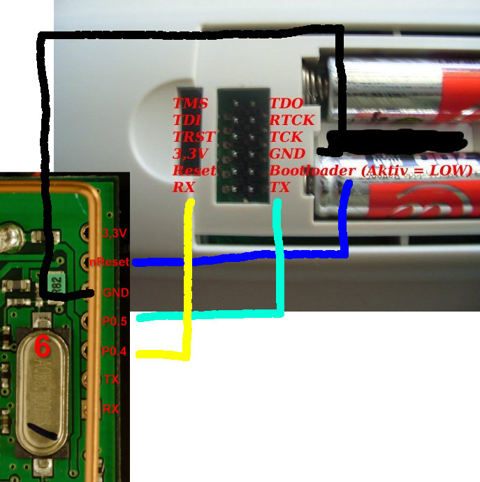

# Betty scart

betty_scart ist eine Firmware für den [Mikrocontroller](SCART%20Adapter%20Hardware.md "SCART Adapter Hardware") (80C51-Derivat) im [SCART Adapter](SCART%20Adapter.md "SCART Adapter").

## Funktion

Sie empfängt Daten von der [Betty](Betty.md "Betty") per Funk und gibt sie über die serielle Schnittstelle aus.

Telekatz: "Übertragung der Tastendrücke an den Scartadapter ist jetzt möglich. Ich habe dafür einen neuen IR encoder hinzugefügt, der anstelle eines IR Signals ein Funkübertragung sendet. Dies ist mit dem Scartadapter im binary mode empfangbar." [Forum](../forum/topics/0014-welches-ziel-mit-der-betty.md#msg822), weitergeführte Diskussion ["Kommunikation Scartadapter"](../forum/topics/0114-kommunikation-scartadapter.md#msg826)

Infos zu Datenrate und Kommandos stehen in der [readme.txt](https://boopfirmware.svn.sourceforge.net/svnroot/boopfirmware/betty_scart/trunk/readme.txt)

## Quellcode

Den aktuellen Source erhält man über [SVN](SVN.md "SVN") [hier](http://boopfirmware.svn.sourceforge.net/viewvc/boopfirmware/betty_scart/trunk/). Das aktuelle RAW-Binary zum download: [betty_scart.bin](https://boopfirmware.svn.sourceforge.net/svnroot/boopfirmware/betty_scart/trunk/betty_scart.bin)

## Entwicklung/Compiler

GCC unterstützt 8051 Mikroprozessoren nicht.

[SDCC](http://sdcc.sourceforge.net/) - Small Device C Compiler ([Download](http://sourceforge.net/projects/sdcc/files/))

Unterstützt den Prozessor (**mcs51**)

- <http://sdcc.svn.sourceforge.net/viewvc/sdcc/trunk/sdcc/device/include/mcs51/P89LPC932.h?view=log>

### Installation

#### Linux

Paket:

    sudo apt-get install sdcc
    sdcc -v

Manuell: Bei manueller Installation aus dem binary (s. Download) und dem Befolgen der Anweisungen in INSTALL.txt Makefile.local:

    SDCCBASE=/usr/local
    INCLUDEPATH=$(SDCCBASE)/share/sdcc/include
    SDCCPATH=$(SDCCBASE)/bin

##### Ubuntu 9.04

- Paket hat keine mcs51 Unterstützung
- Das binary package (siehe Download Link) funktioniert

##### Ubuntu 9.10

- 9.10 supports mcs51/gbz80/z80/avr/ds390/pic16/pic14/TININative/xa51/ds400/hc08 ([bug](https://bugs.launchpad.net/ubuntu/+source/sdcc/+bug/412761))

## Firmware flashen

Der Mikrocontroller verfügt über einen Bootloader, mit dem über die ICP/ISP Schnittstelle die Firmware geladen werden kann. Siehe [Datenblatt](http://ics.nxp.com/support/documents/microcontrollers/pdf/user.manual.p89lpc9301.p89lpc931a1.pdf) ab S. 97.

### Mit dem PC über einen Adapter

- [SCART-Betty-Kombiinterface](SCART-Betty-Kombiinterface.md "SCART-Betty-Kombiinterface")
- ScartProg [Forum](../forum/topics/0176-flashen-des-scart-adapters-und-einen-guten-rutsch-ins-jahr-2.md)
- NXPs Adapter (<http://ics.nxp.com/support/development.hardware/fdi.usb-icp-80c51isp/~P89C664/>)

### Mit Betty

Verbindungen zwischen betty SCART adapter

Die Firmware des SCART-Adapters lässt sich mit der Betty ohne zusätzliche Hardware (außer einem entsprechenden Kabel) flashen. Die dazu nötigen Routinen sind in Boop bereits integriert, die zu flashende Firmware muß allerdings in Boop mit hinein-compiliert werden. [\[1\]](../forum/topics/0148-scart-programmieren-ohne-kombi-interface.md)

1.  betty_scart.bin in ein Werte-Array in C-Quellcode umwandeln
    1.  Windows: <http://www.ulrichradig.de/home/index.php/projekte/winbin>
    2.  Python: [boop_icp.py](http://boopfirmware.svn.sourceforge.net/viewvc/boopfirmware/betty_scart/trunk/boop_icp.py?view=log)
2.  als boopfirmware/boop/trunk/tools/scart_image.h speichern
3.  boop kompilieren
4.  boop_rom.bin flashen
5.  betty mit scart-adapter verbinden
6.  betty\>tools\>ICP

---

[Startseite](Main%20Page.md) · [Index](../index.md) · [Kategorien](../categories.md)

