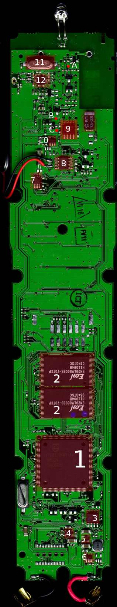

# Betty-Hardware

<table width="100%">
<colgroup>
<col style="width: 50%" />
<col style="width: 50%" />
</colgroup>
<tbody>
<tr>
<td data-valign="top" width="70%"><h2 id="Bauteile">Bauteile</h2>

<strong>[LCD] (auf Vorderseite)</strong> 
160 x 128 Pixel (aktive Fläche ca. 38 mm ∙ 30 mm) 
4 Graustufen LCD 
Controller: SSD1854 
<a href="http://bettyhacks.com/forum/index.php?topic=51.msg314#msg314">Forum</a> <a href="http://www.solomon-systech.com/news/press300301.htm">Press-Release</a> <a href="http://pdf1.alldatasheet.net/datasheet-pdf/view/103925/ETC/SSD1854.html">Datenblatt</a> <a href="http://web.archive.org/web/20050311074435/http://www.solomon-systech.com/products/ssd1854.htm">Datenblatt</a> 
20 pins, flex connector probably glued with anisotropic adhesive - can be pulled off gently while leaving wires on flex intact. 
Foto <a href="http://bettyhacks.com/wiki/index.php/Image:Betty-tv_lcd1.jpg">1</a> <a href="http://bettyhacks.com/wiki/index.php/Image:Betty-tv_lcd2.jpg">2</a> 

<strong>[A]</strong> IR senden (LPC2220 Pin: 4) 

<strong>[B]</strong> IR an/aus (LPC2220 Pin: 84) 

<strong>[C]</strong> IR empfang (LPC2220 Pin: 32) 

<strong>[1]</strong> <a href="LPC2220.md" title="LPC2220">LPC2220</a> - 32bit arm7tdmi-s cpu

<ul>
<li><ul>
<li>64kbyte sram</li>
<li>serial bootloader using uart0</li>
<li>flashless</li>
<li>external memory interface
<ul>
<li>banks: 4x16 MByte</li>
<li>8/16/32 data width</li>
<li>memory mapped: ram, rom, some i/o</li>
</ul></li>
</ul></li>
<li>PLL-Input 10MHz Crystal</li>
</ul>

<a href="http://www.keil.com/dd/docs/datashts/philips/lpc2210_2220.pdf">Datasheet</a> <a href="http://www.nxp.com/acrobat_download/usermanuals/UM10114_1.pdf">Usermanual</a>

<strong>[2]</strong> en29lv800 - flash speicher

<ul>
<li><ul>
<li>8mbit: 1024k * 8bit / 512k * 16bit</li>
<li>sector protection/unprotection</li>
<li>the first (from cpu counted) is the word-mode(16-bit) CS0-BootFlash</li>
<li>the second is word-mode(16-bit) CS2-Flash</li>
</ul></li>
</ul>

<a href="http://www.eonsdi.com/upfile/p2008929172119.pdf">Datasheet EN29LV800B</a>

<strong>[3]</strong> <a href="SLE%2066C24PE%20-%20Security%20Chip%20Card%20IC.md" title="SLE 66C24PE - Security Chip Card IC">SLE 66C24PE - Security Chip Card IC</a>

<ul>
<li><ul>
<li>8/16Bit Security Controller</li>
<li>CMOS Technology</li>
<li>68kbyte ROM, 2304 Byte RAM, 2Kbyte EEPROM</li>
<li>Dual Key Triple DES</li>
</ul></li>
</ul>

<strong>[4]</strong> <a href="AAT3242%20-%20dual%20low%20dropout%20regulator.md" title="AAT3242 - dual low dropout regulator">AAT3242 - dual low dropout regulator</a>

<ul>
<li><ul>
<li>Channel A: 3,0V/300mA (Ue-Ua &gt; 400mV)</li>
<li>Channel B: 1,8V/150mA (Ue-Ua &gt; 200mV)</li>
</ul></li>
</ul>

<a href="http://www.analogictech.com/products/digitalfiles/AAT3242.pdf">Datasheet AAT3242</a>

<strong>[5]</strong> <a href="AAT1265%20-%20Step-up%20DC_DC%20converter.md" title="AAT1265 - Step-up DC/DC converter">AAT1265 - Step-up DC/DC converter</a>

<ul>
<li><ul>
<li>3,6V output</li>
<li>100mA Output from a Single AA Cell Input</li>
<li>250mA Output from a Dual AA Cell Input</li>
<li>400mA Output from a Single Lithium-Ion Cell Input</li>
<li>VIN Operation Range: 0.8V to VOUT</li>
<li>Up to 93% Efficiency</li>
<li>Low Start-Up Voltage: 1.0V Typical</li>
<li>Internal Synchronous Rectifier</li>
<li>Current Mode Control with Internal Feedback and Compensation</li>
<li>2MHz Fixed Switching Frequency</li>
<li>1A Current Limit</li>
<li>Maintains High Efficiency Over the Output Current Range for Improved Battery Life</li>
<li>Low 40μA No Load Bias Current</li>
<li>True Load Disconnect</li>
<li>Short-Circuit and Over-Current Protection</li>
<li>Inrush Current Limit and Soft Start</li>
<li>Low Shutdown Current: &lt;1.0μA</li>
</ul></li>
</ul>

<a href="http://www.analogictech.com/products/digitalfiles/AAT1265.pdf">Datasheet AAT1265</a>

<strong>[6]</strong> Fill me!

<strong>[7]</strong> PCF8563

<ul>
<li><ul>
<li>RTC-Chip with I2C-Connect</li>
<li>I2C-bus slave address: read A3h and write A2h</li>
</ul></li>
</ul>

<a href="http://www.nxp.com/acrobat/datasheets/PCF8563_6.pdf">Datasheet</a> <a href="http://www.nxp.com/documents/application_note/AN10652.pdf">Appnote</a>

<strong>[8]</strong>

<ul>
<li><ul>
<li>LM4876M</li>
<li>1.1W Audio Power Amplifier with Logic Low Shutdown</li>
</ul></li>
</ul>

<a href="http://cache.national.com/ds/LM/LM4876.pdf">Datasheet</a> <a href="http://www.national.com/mpf/LM/LM4876.html">Overview</a>

<strong>[9]</strong>

<ul>
<li><ul>
<li>LM393 Dual Komparator - digitalisiert Signal von der IR-LED zum Empfang.</li>
</ul></li>
</ul>

<a href="http://www.national.com/ds/LM/LM193.pdf">Datasheet</a> <a href="http://www.national.com/mpf/LM/LM393.html">Overview</a>

<strong>[10]</strong> Fill me!

<strong>[11]</strong> 27MHz Quarz

<ul>
<li>crystal for cc1100</li>
</ul>

<strong>[12]</strong> RF transceiver<a href="CC1100.md" title="CC1100">CC1100</a>

<ul>
<li><ul>
<li>315/433/868/915 MHz</li>
<li>2x64byte rx, tx fifo</li>
<li>spi interface</li>
</ul></li>
</ul>

<a href="http://focus.ti.com/lit/ds/symlink/cc1100.pdf">Datasheet</a> <a href="http://focus.ti.com/docs/prod/folders/print/cc1100.html">Overview</a>

</td>
<td style="text-align: right;">

Alle Chips sind rot markiert und nebenan beschrieben
</td>
</tr>
</tbody>
</table>

<table width="100%">
<colgroup>
<col style="width: 50%" />
<col style="width: 50%" />
</colgroup>
<tbody>
<tr>
<td data-valign="top" width="70%"><h2 id="Anschlussbelegung">Anschlussbelegung</h2>

Service-Stecker (Batteriefach)

<pre><code>TMS      1  2    TDO
TDI      3  4    RTCK
nTRST    5  6    TCK
3,3V     7  8    GND
nReset   9  10   Bootloader EN, Aktiv = LOW (EINT1)
RX      11  12   TX</code></pre>

Besseres Bild: <a href="http://www.grautier.com/grautier/uploads/Elektronik/Betty/RIMG0001.JPG">http://www.grautier.com/grautier/uploads/Elektronik/Betty/RIMG0001.JPG</a>
</td>
<td style="text-align: right;">

Service-Stecker
</td>
</tr>
</tbody>
</table>

---

[Startseite](Main%20Page.md) · [Index](../index.md) · [Kategorien](../categories.md)

