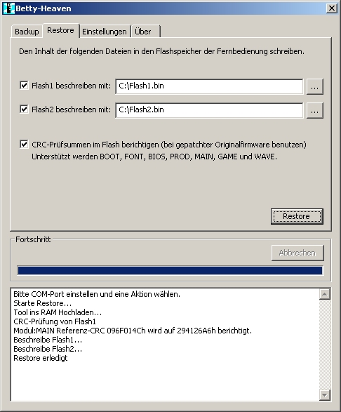

# Betty-Heaven

Auf der Webseite [\[1\]](http://colibri.bplaced.net/Betty.htm) gibts ein Windows-Tool "Betty-Heaven" mit dem man mit der Betty Fernbedienung Daten austauschen kann. Hier eine lokale Kopie des Tools media:Betty-Heaven.zip

- Es wird "Microsoft Visual C++ 2008 Redistributable Package" [\[2\]](http://www.microsoft.com/downloads/details.aspx?FamilyID=9B2DA534-3E03-4391-8A4D-074B9F2BC1BF&displaylang=de) bzw. "Microsoft Visual C++ 2005 Redistributable Package" [\[3\]](http://www.microsoft.com/downloads/details.aspx?familyid=32BC1BEE-A3F9-4C13-9C99-220B62A191EE&displaylang=en) benötigt!
- Der Quellcode ist nicht einsehbar.
- Auch ein Packet "Betty-Dumps.zip" ist dort zu finden in dem die Flash-Dumps, der ISP-BootLoader und aus der Firmware gerippte .wav Dateien enthalten sind. Lokale Kopie: media:Betty-Dumps.zip
- Zur Übertragung wird ein Adapter benötigt: [Interfaces_PC_zu_Betty](Interfaces%20PC%20zu%20Betty.md "Interfaces PC zu Betty")
- Zum Starten des Bootloaders werden die Leitungen ? (eINT1) und ? (RESET) verwendet.

Die Version 1.05 beherrscht folgende Funktionen:

**Betty Fernbedienung:**

- Das Flash kann auslesen und beschrieben werden.
- Ist die Quelldatei kleiner als das Flash, dann wird das restliche Flash nicht geloescht, sondern bleibt erhalten. Das ist wichtig falls Konfigurationsdaten am Ende vom Flash vorhanden sind die beim Aktualisieren der Firmware nicht geloescht werden sollen.
- Programmen koennen ins RAM geladen und ausgefuehrt werden.

**Scart-Adapter:**

- Der Flashspeicher vom P89LPC931-Chip kann ausgelesen und beschrieben werden.

  
Screenshot von der alten Version 1.04:

---

[Startseite](Main%20Page.md) · [Index](../index.md) · [Kategorien](../categories.md)

