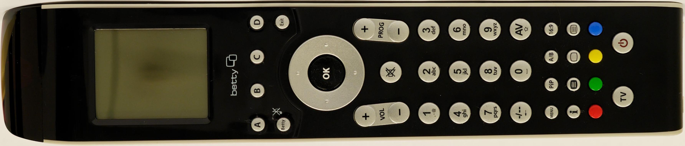
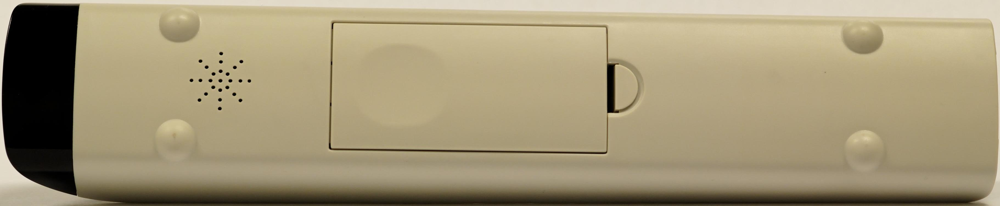
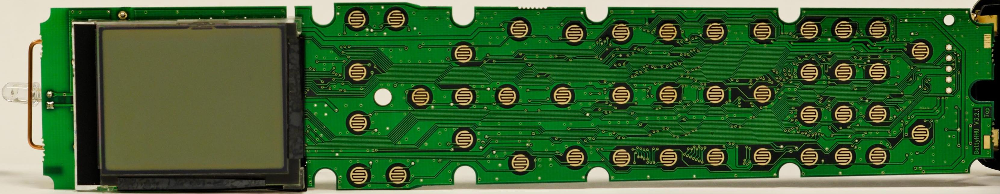
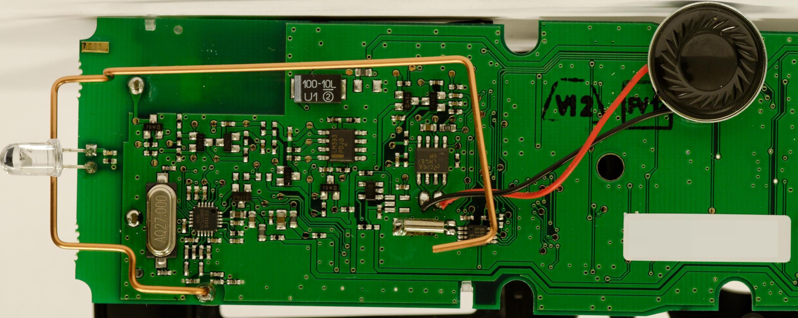
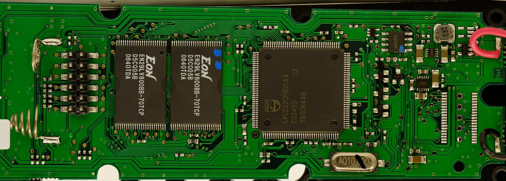

# Betty

## Lieferumfang

Die Betty wird mit zwei NI-MH Akkus (700mAh), der [Ladestation](Ladestation.md "Ladestation"), sowie dem [SCART Adapter](SCART%20Adapter.md "SCART Adapter") geliefert. Enthalten ist ebenso entweder der [TAE Adapter](TAE%20Adapter.md "TAE Adapter") oder der [IP Adapter](IP%20Adapter.md "IP Adapter"), abhängig von den Angaben über die vorhandenen Telefone.

## Funktion mit der Original-Firmware

Die Betty nimmt Daten vom SCART Adapter per Funk entgegen und wertet diese zu Gewinnspielen und Umfragen aus.

Alle so gesammelten Daten werden in regelmäßigen Intervallen an die Betty TV AG übermittelt. Dafür werden die Daten zunächst per Funk an den TAE Adapter oder den IP Adapter übermittelt.

Richtige Antworten werden mit so genannten Sofameilen belohnt.

## Betty öffnen

Batteriefach öffnen und Akkus entfernen - dort befindet sich eine Schraube, die gelöst werden muss.

Anschließend den vorderen Teil der Betty (Infrarotteil) von der Unterseite leicht nach oben drücken (maximal einen halben Zentimeter). Dadurch wird die Abdeckung leicht angehoben und kann vorsichtig bis zum anderen Ende hochgehebelt werden - Fingernägel oder ein Schlitzschraubendreher dürften hier hilfreich sein. Die Teile sind nur aufeinander gesteckt - es gibt keine Widerhaken, die zurückgedrückt werden müssen! Am unteren Ende sind die Ladekontakte an die Platine gelötet und verhindern ein komplettes Abnehmen der Abdeckung.

Sobald die Abdeckung auf ganzer Länge gelöst ist, kann das Innenleben mitsamt der Abdeckung entnommen werden. Gegebenenfalls die Betty umdrehen und durch Druck auf die Stiftleisten etwas nachhelfen.

Überlegt euch vorher, ob ihr genug handwerkliches Geschick besitzt, um die Betty nachher wieder richtig zusammenzusetzen...

## Hardware der Betty

Für die Übersichtlichkeit ausgelagert in [Betty Hardware](Betty%20Hardware.md "Betty Hardware").

<!-- forum-links:start -->
## Forumsdiskussionen: Einstieg, Ziele und Bezugsquellen

Einordnung und Einstieg: Ziele und Nutzungsszenarien, Bezugsquellen (Pollin), Marktwert und Betrieb mit anderen Sendern.

### Welches Ziel mit der Betty?

- [Welches Ziel mit der Betty???](https://github.com/ghenne/betty-forum/blob/main/topics/0014-welches-ziel-mit-der-betty.md) — Grundsatzdiskussion zu Zielen und Nutzungsszenarien.

### Betty, andere Sender?

- [Betty, andere Sender?](https://github.com/ghenne/betty-forum/blob/main/topics/0056-betty-andere-sender.md) — Betty mit anderen Sendern/Quellen nutzen.

### Bezugsquellen und Marktwert

- [Bettys Wert](https://github.com/ghenne/betty-forum/blob/main/topics/0020-bettys-wert.md) — Marktwert und Preise für Bettys.
- [Bettys bei Pollin](https://github.com/ghenne/betty-forum/blob/main/topics/0279-bettys-bei-pollin.md) — Bettys bei Pollin: Bezug und Erfahrungen.

### Einstieg: Betty von Pollin, Software woher?

- [Newby: Betty von Pollin, Software von wo?](https://github.com/ghenne/betty-forum/blob/main/topics/1051-newby-betty-von-pollin-software-von-wo.md) — Einstieg mit einer Pollin-Betty: welche Software, welche Toolchain.
- [Bettys bei Pollin](https://github.com/ghenne/betty-forum/blob/main/topics/0279-bettys-bei-pollin.md) — Bettys bei Pollin: Bezug und Erfahrungen.
<!-- forum-links:end -->

---

[Startseite](Main%20Page.md) · [Index](../index.md) · [Kategorien](../categories.md)

