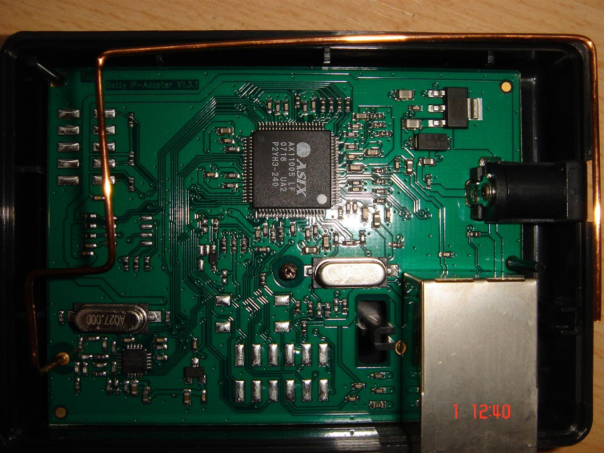
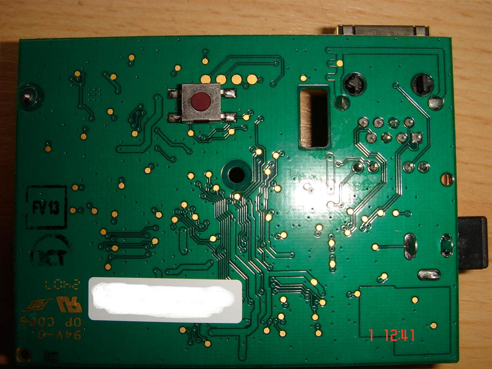
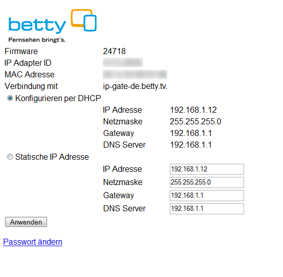
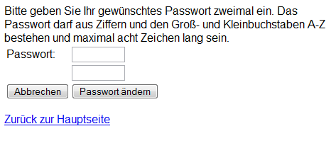

# IP Adapter

## Funktion mit der Original-Firmware

Der IP Adapter ermöglicht der [Betty](Betty.md "Betty") die Kommunikation mit der Zentrale der Betty TV AG.

Es wird bei Bedarf eine Verbindung zum Server aufgebaut, über die z.B. Spielstände gesendet und Updates empfangen werden können.

Der Adapter ist für Haushalte gedacht, die nicht über einen analogen Telefonanschluss verfügen, jedoch ein Netzwerk mit Internetzugang bieten können.

## Hardware

[IP Adapter Hardware](IP%20Adapter%20Hardware.md "IP Adapter Hardware")

## Serielle Logs

### Ohne Netzwerk

    Betty IPAdapter bootloader 20777
    (c) 2006,2007 Betty TV Entwicklungs GmbH
    Compiled Jun 25 2007, 11:58:19
    �Starting firmware revision 20777 ...
    Betty IPAdapter build 20777, compiled Jun 25 2007, 11:58:23
    (c) 2006,2007 Betty TV Entwicklungs GmbH
    Bootloader build 20777
    HW revision 0
    MAC 00:1c:03:XX:XX:XX
    ID  XXXX-XXXX
    Source IP:�0.0.0.0
    Subnet mask:�0.0.0.0
    Gateway:�0.0.0.0

### Mit Netzwerk

    Betty IPAdapter bootloader 20777
    (c) 2006,2007 Betty TV Entwicklungs GmbH
    Compiled Jun 25 2007, 11:58:19
    �Starting firmware revision 20777 ...
    Betty IPAdapter build 20777, compiled Jun 25 2007, 11:58:23
    (c) 2006,2007 Betty TV Entwicklungs GmbH
    Bootloader build 20777
    HW revision 0
    MAC 00:1c:03:XX:XX:XX
    ID  XXXX-XXXX
    Source IP:�0.0.0.0
    Subnet mask:�0.0.0.0
    Gateway:�0.0.0.0
    PHY link status changed.
    Set link to 100 full duplex.
    DHCP: send DHCPDISCOVER.
    DHCP: resend DHCPDISCOVER.
    DHCP: resend DHCPDISCOVER.
    DHCP: resend DHCPDISCOVER.
    DHCP: received offer.
    DHCP: aquired IP address.
    New IPv4 settings: inet 192.168.10.20 netmask 255.255.255.0 gateway 192.168.10.1 dns 192.168.10.1

## Webserver

"index.html"-Seite des IP-Adapters

"Passwort ändern"-Seite des IP-Adapters

"prodtest.html"-Seite des IP-Adapters

Wenn man mit dem Browser auf die IP des Adapters geht, kommt ein Login.

### Zugangsdaten

User leer lassen und Passwort ist Betty.

### Versteckte Seite im IP Adapter

Versteckt, aber unbrauchbar: <http://betty-ip/prodtest.html>

## Firmware Update

### Benötigte Hardware

- USB-Seriell Wandler oder RS232 port + Pegelwandler. Dazu noch 2 Taster bzw. einer würde auch reichen. (zur not auch eine Kabelbrücke um in den Bootloader zu kommen)
- ISP Flashtool von ASIX.

### Firmware einspielen

- Den AX11005 Bootloader (für ISP flash) starten
- Boot PIN auf VCC legen und Reset (auf Masse) ausführen bzw. Hohlstecker einstecken.
- ASIX Bootloader flashen um über das Netzwerk neue Firmware zu laden.

---

[Startseite](Main%20Page.md) · [Index](../index.md) · [Kategorien](../categories.md)

