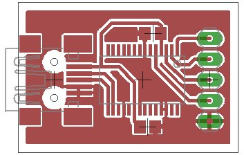
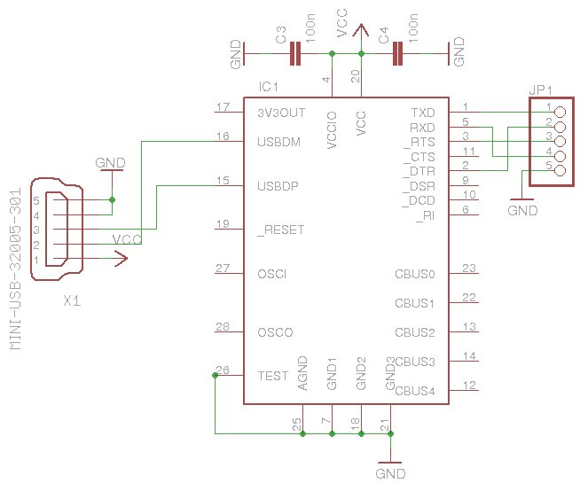
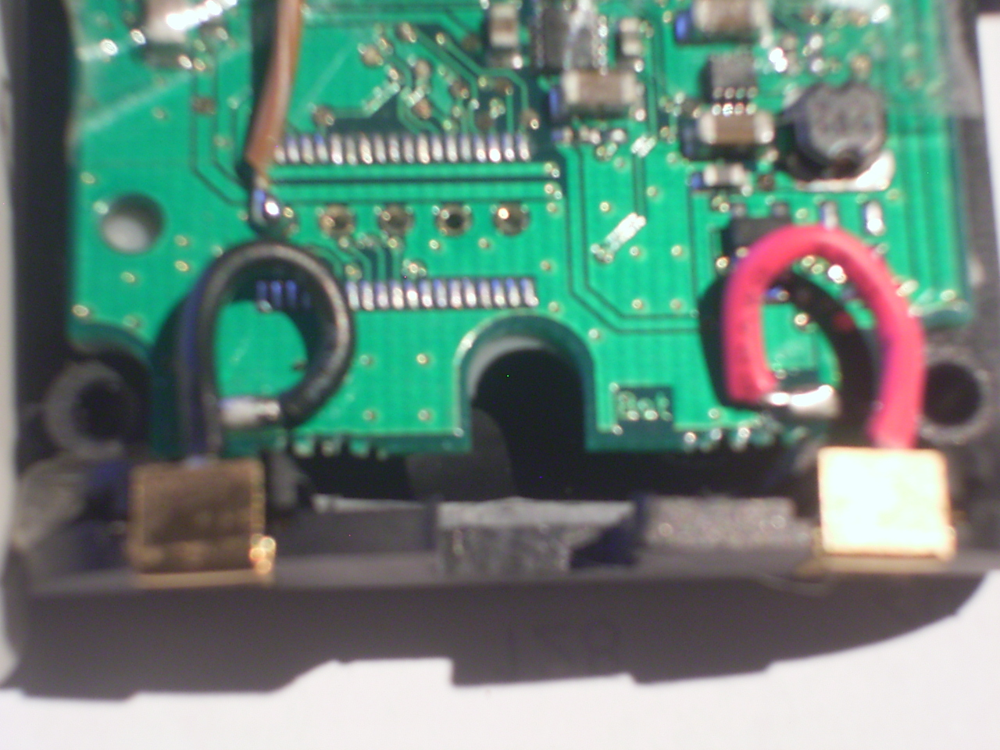

# Int. USB und Laderegler

### Hier geht es um den Einbau eines FTDI (FT232RL) USB2Serial Wandlers.

    * Die Schaltung ist nicht ganz optimal es fehlt wegen dem wenigen Platz etwas Beschaltung an dem USB Port.
    * Laden per USB fehlt noch, ist aber in Arbeit.

    * Es ist möglich über den eingebauten Adapter auch eine andere Betty zu Flashen einfach die Pins durch verbinden,
    * in der Betty mit dem Adapter dürfen dann aber keine Batterien eingelegt sein.

Eagle Dateien: [Hier](http://www.grautier.com/GrautierDL/usb2ser.tar.gz)

--Theborg 10:33, 24 February 2009 (UTC)

---

[Startseite](Main%20Page.md) · [Index](../index.md) · [Kategorien](../categories.md)

