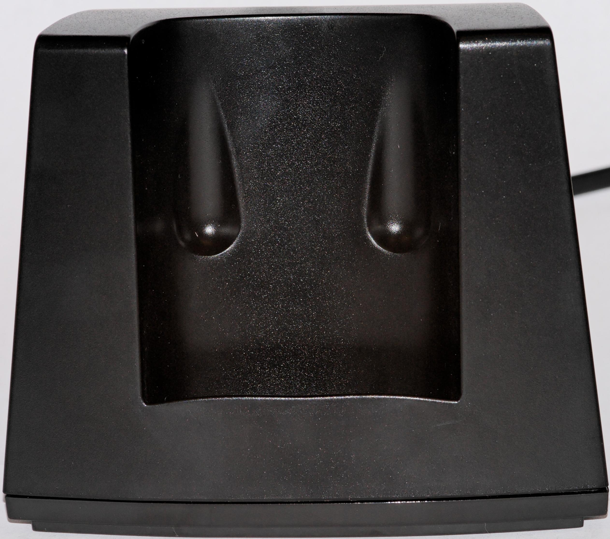
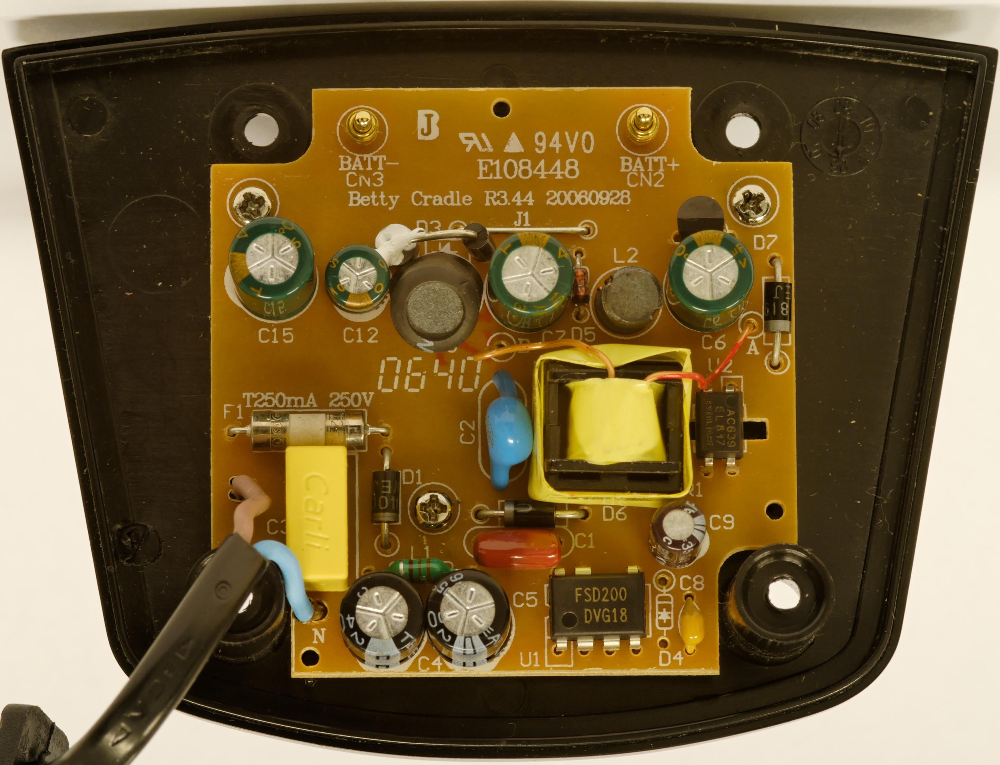

# Ladestation

Das Netzteil des [SCART_Adapter_Hardware#Netzteil](SCART%20Adapter%20Hardware.md "SCART Adapter Hardware") ist aus ähnlichen Komponenten aufgebaut.

## Funktion

Steht die Betty in der Ladestation, werden die beiden NI-MH Akkus (700-1000mAh) der Betty geladen.

**getaktetes Schaltnetzteil:**

- FSD200 - 7-beiniger(!) PWM Schaltregler \[[Datenblatt](http://www.datasheetcatalog.com/datasheets_pdf/F/S/D/2/FSD200.shtml)\]
- EL817 - ein einfacher Optokoppler
- AZ431 - (=TL431) Präzisions-Shunt-Regler auf der Sekundärseite des Netzteils \[[Datenblatt](http://www.alldatasheet.com/datasheet-pdf/pdf/137188/BCDSEMI/AZ431-A.html)\]
- Ausgangsspannung 4.2 V (vor Laderegler abgreifen)

**Ladeschaltung:**

- 9202 - PWM Laderegler (10 pins, SMD. Keine Daten zu finden.)

## Modifikationen

[Umbau auf LiIon Akku](Umbau%20auf%20LiIon%20Akku.md "Umbau auf LiIon Akku")

---

[Startseite](Main%20Page.md) · [Index](../index.md) · [Kategorien](../categories.md)

