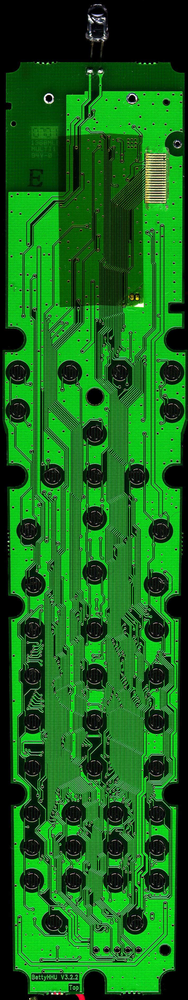
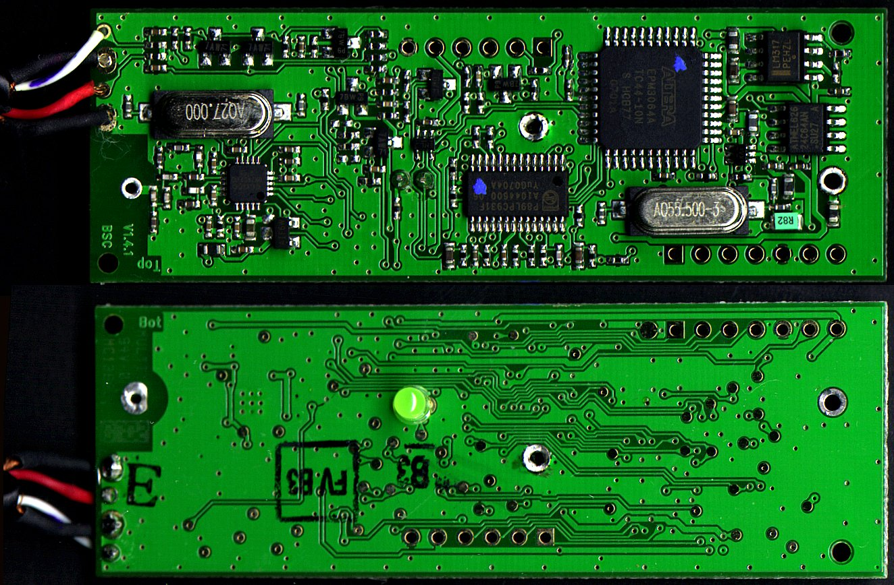
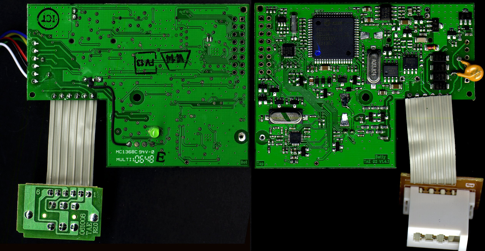

# Pictures

### Betty HHU

Betty-Hauptplatine-Unterseite

Betty-Hauptplatine-Oberseite

### Scart-Adapter

Betty-Scart-Adapter

### TAE-Adapter

Betty-TAE

---

[Startseite](Main%20Page.md) · [Index](../index.md) · [Kategorien](../categories.md)

