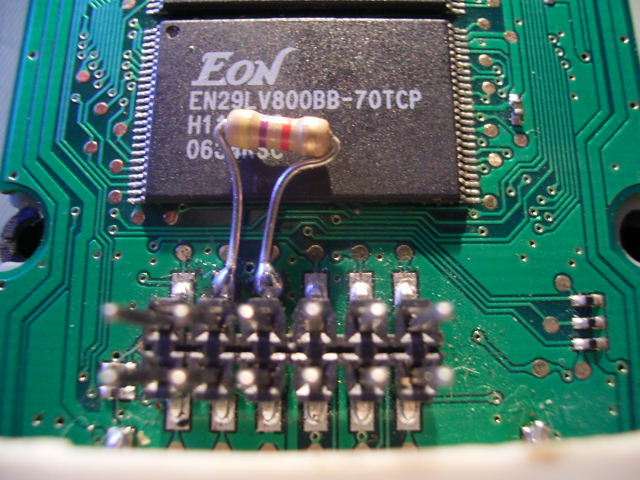

# Reparaturanleitungen

### Betty startet ständig neu oder bootet nicht

Wenn eure Betty permanent neu startet oder sich gar nicht erst einschalten lässt, kann man am Pinheader beim Batteriefach mal versuchen einen 4,7K Widerstand zwischen dem 3.3V PIN und Reset anzulöten - danach sollte es wieder gehen. Der Widerstand muss genau 4,7K haben, nicht mehr und nicht weniger, sonst geht das nicht oder es treten andere Defekte auf.

Achtung !!! Dabei verliert die Betty ihre Garantie wenn ihr das nicht möchtet, würde ich den Widerstand auf einen Pinheader Stecker löten und auf den Pinheader stecken.

---

[Startseite](Main%20Page.md) · [Index](../index.md) · [Kategorien](../categories.md)

