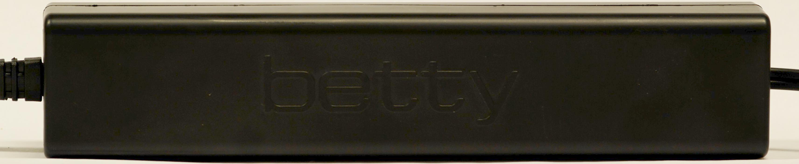
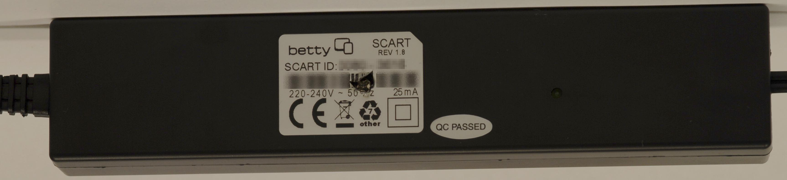
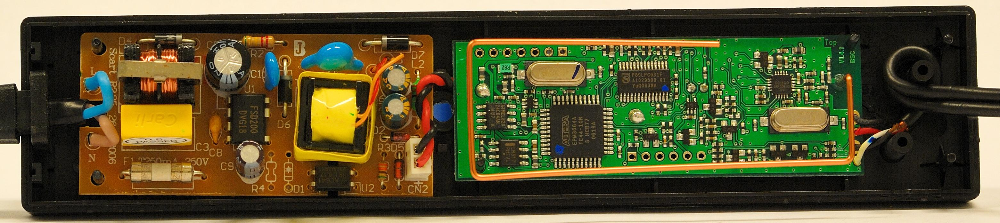
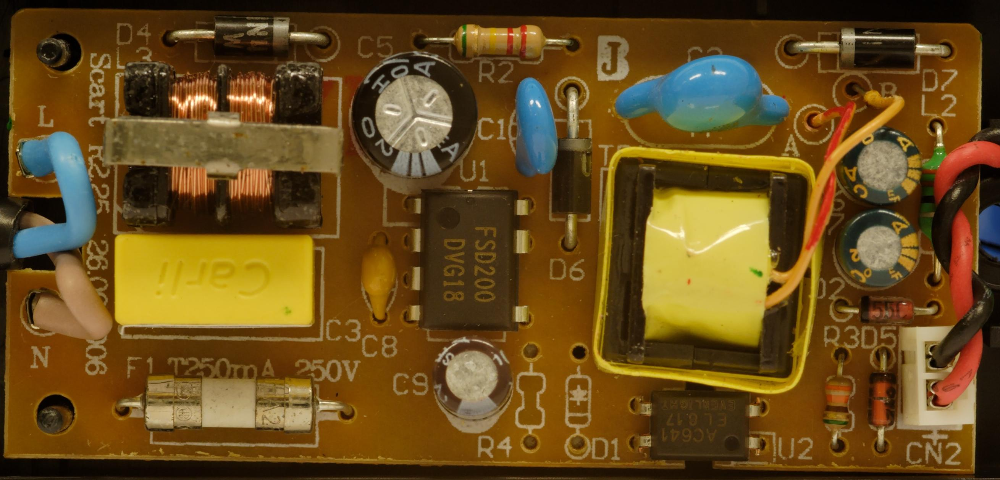
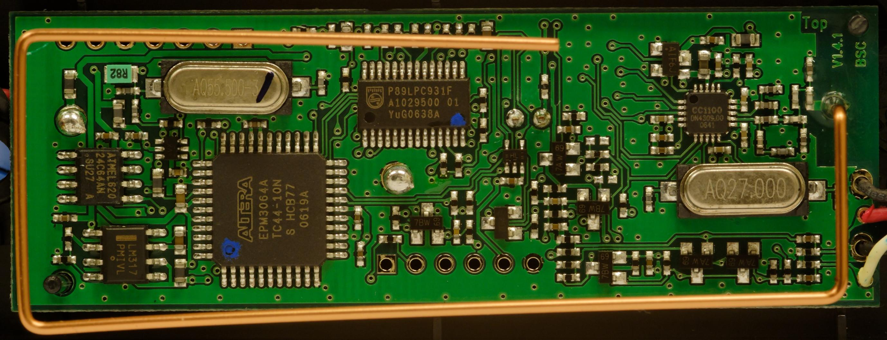
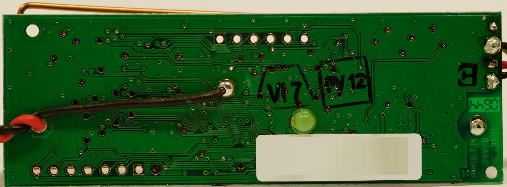

# SCART Adapter

Der [SCART](http://de.wikipedia.org/wiki/SCART) Adapter wird an den SCART-Anschluss eines Fernsehers oder Videorecorders angeschlossen und greift das anliegende Videosignal ab. Daraus extrahiert er den Videotext und die für die [Betty](Betty.md "Betty") relevanten Daten. Diese werden dann per Funk an die Betty geschickt, wo sie weiter verarbeitet werden.

  

## SCART Adapter öffnen

Auf der Rückseite mittig unter dem Aufkleber befindet sich eine Schraube. Sobald diese gelöst ist, können die beiden Teile einfach auseinander gezogen werden - Fingernägel oder ein Schlitzschraubendreher dürften hier hilfreich sein. Die Teile sind nur aufeinander gesteckt - es gibt keine Widerhaken, die zurückgedrückt werden müssen!

## Firmware

Für den [Mikrocontroller](SCART%20Adapter%20Hardware.md "SCART Adapter Hardware") (80C51-Derivat) existiert eine alternative Firmware, [Betty-scart](Betty-scart.md "Betty-scart").

## Hardware

[SCART Adapter Hardware](SCART%20Adapter%20Hardware.md "SCART Adapter Hardware")

<!-- forum-links:start -->
## Forumsdiskussionen: Programmierung und Terminalmodus

Der SCART-Adapter lässt sich auch ohne Kombi-Interface programmieren; zusätzlich ist ein Terminalmodus mit seriellen Einstellungen dokumentiert.

### SCART programmieren ohne Kombi-Interface

- [Scart programmieren, ohne Kombi-Interface!!](https://github.com/ghenne/betty-forum/blob/main/topics/0148-scart-programmieren-ohne-kombi-interface.md) — SCART-Adapter ohne Kombi-Interface programmieren; ICP-Routinen auf andere Mikrocontroller portiert.

### SCART-Terminalmode

- [Scart - Terminalmode](https://github.com/ghenne/betty-forum/blob/main/topics/0226-scart-terminalmode.md) — Terminalmodus des SCART-Adapters mit seriellen Einstellungen (38400,n,8,1).
<!-- forum-links:end -->

---

[Startseite](Main%20Page.md) · [Index](../index.md) · [Kategorien](../categories.md)

