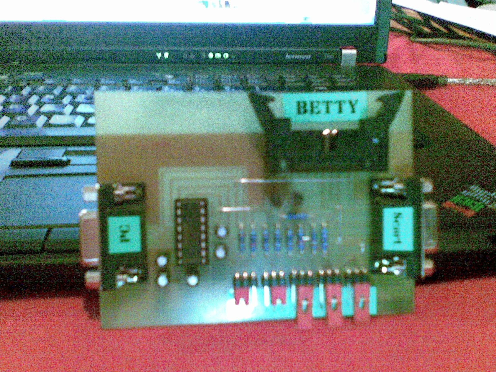
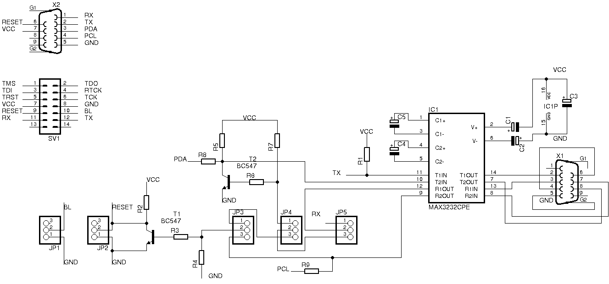

# SCART-Betty-Kombiinterface

Mit dem Scart-Betty-Kombiinterface können nicht nur wie bei den bisher verfügbaren Interfaces mit der [Betty](Betty.md "Betty"), sondern auch mit dem [SCART Adapter](SCART%20Adapter.md "SCART Adapter") Daten ausgetauscht werden.

# Schaltplan

Beispielaufbau

geätzte Platine

Schaltplan

[Scart-Betty-Kombiinterface.pdf](http://colibri.net63.net/Scart-Betty-Kombiinterface.pdf)

Da der RS232 Pegelwandler nur 2 Eingaenge und 2 Ausgaenge hat und diese nicht einmal fuer den Anschluss des Scart-Adapters ausreichen, besitzt das Interface Jumper um zwischen den verschiedenen Betriebsmodi zu wechseln.

**Achtung:** Es darf nur die Betty oder der Scart-Adapter mit dem Interface verbunden werden, aber nicht beide gleichzeitig, da die Tx-Leitungen und auch die Versorgungsspannungen miteinander verbunden sind.

Es ist kein seperates Netzteil für das Interface notwendig, da die Betriebsspannung aus dem Scart-Adapter bzw. der Betty entnommen wird.

# Eagle-Dateien

Für alle, die lieber Ätzen als auf Lochraster zu bauen: [Eagle Dateien](http://www.rsp-design.de/betty/kombi.rar)

# Jumpereinstellungen

## Betty

Fuer das Programmieren, Auslesen der Betty oder um Programme ins RAM zu laden und auszuführen ist folgende Jumpereinstellung zu verwenden:

    sw1 geschlossen (ISP Bootloader aktiv)
    sw2 offen (Reset über PC gesteuert)
    sw3 2-3 (Resetsteuerung über RTS)
    sw4 egal (nur für Scart-Adapter relevant)
    sw5 1-2 (PC TxD steuert Device Rx)

Will man verhindern das eine ins RAM geladene und gestartete Applikation beim Schliessen von Betty-Heaven beendet wird, muss man vor dem Schliessen den Jumper sw3 auf 1-2 umstecken. Dann kann man das Hyperterminal starten um Befehle z.B. zur boop-Applikation zu schicken um Grafiken auf das Display zu zaubern.

## Scart-Adapter

Beim Programmieren und Auslesen des Flashes im Scart-Adapter erscheint folgende Meldung im Betty-Heaven:

    Bitte folgende Schritte ausführen:
    - Scart-Adapter ausschalten
    - Jumper sw1 ist egal (steuert nur die Betty)
    - Jumper sw2 schliessen (Dauerreset)
    - Jumper sw3 auf 1-2 (Resetsteuerung über TxD) stecken
    - Jumper sw4 auf 2-3 (PC TxD steuert Reset) stecken
    - Jumper sw5 auf 2-3 (PC TxD steuert PDA/Reset) stecken
    - Scartgerät einschalten
    - Jumper sw2 oeffnen (Reset über PC gesteuert)
    - dann erst auf OK klicken

Im Hintergrund wird jetzt die ICP-Entering-Sequenz an die Resetleitung vom Scart-Adapter geschickt. Anschliessend muss der Jumper sw4 wieder geändert werden damit Daten über die PDA-Leitung ausgetauscht werden koennen.

    Bitte folgende Schritte ausführen:
    - Jumper sw4 auf 1-2 (PC TxD steuert PDA) stecken
    - dann erst auf OK klicken

  
Wenn mit dem Programm im Scart-Adapter über die UART-Schnittstelle kommuniziert werden soll, ist folgende Jumpereinstellung zu verwenden:

    sw1 egal (nur für Betty relevant)
    sw2 offen (Reset über PC gesteuert)
    sw3 2-3 (Resetsteuerung über RTS)
    sw4 egal
    sw5 1-2 (PC TxD steuert Device Rx)

<!-- forum-links:start -->
## Forumsdiskussionen: Platine und Schaltplan

Platine, Schaltplan und Aufbau des Kombiinterfaces.

### Kombiinterface: Platine und Schaltplan

- [Kombiinterface Schaltplan](https://github.com/ghenne/betty-forum/blob/main/topics/0248-kombiinterface-schaltplan.md) — Schaltplan des Kombiinterfaces.
- [Kombiinterface Platine](https://github.com/ghenne/betty-forum/blob/main/topics/0125-kombiinterface-platine.md) — Platine des Kombiinterfaces.
<!-- forum-links:end -->

---

[Startseite](Main%20Page.md) · [Index](../index.md) · [Kategorien](../categories.md)

