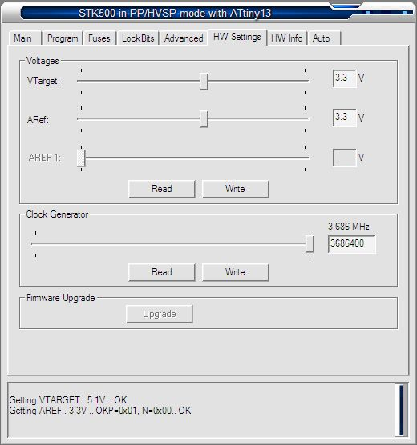
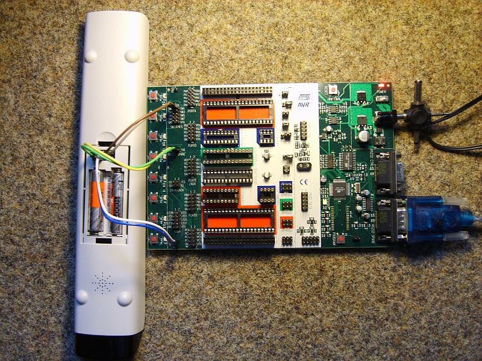

# Stk500

When you own a atmel STK500 development board, you can flash your betty very easy!

  

### Board-Settings

Settings

The target and reference-voltage should be set to 3.3V. This step is optional because the LPC2220 pins are 5V tolerant.

  

### Cable Connections

Connections

You must connect the RS232-Cable to RS232-Spare on the board.

|            |        |
|------------|--------|
| Betty      | STK500 |
| RXD        | RXD    |
| TXD        | TXD    |
| Reset      | SW1    |
| Bootloader | SW0    |
| GND        | GND    |

Betty-ISP

### Software

You can use a flash-tool of your choice ;)

---

[Startseite](Main%20Page.md) · [Index](../index.md) · [Kategorien](../categories.md)

