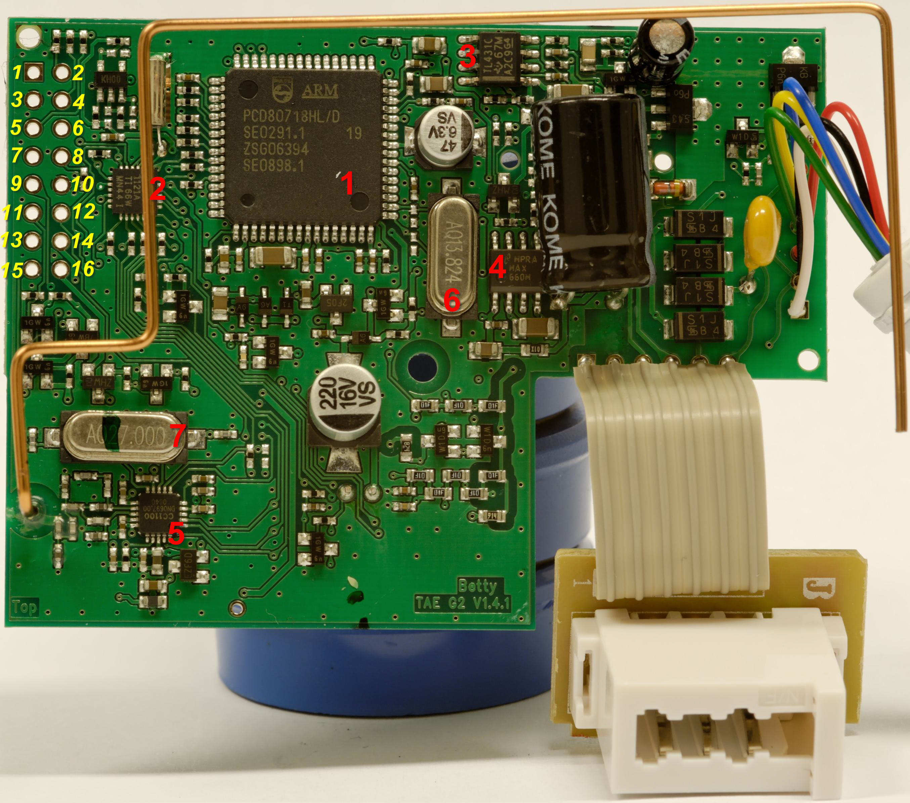

# TAE Adapter Hardware

Siehe [TAE Adapter](TAE%20Adapter.md "TAE Adapter")

## Allgemeines

- Betty TAE G2 V1.4.1 \|MC1368C94v-0 - MULTI1 0701
- Spannungsversorgung über das Telefon
- [TAE](http://de.wikipedia.org/wiki/Telekommunikations-Anschluss-Einheit) Stecker / Buchse ([a/b-Schnittstelle](http://de.wikipedia.org/wiki/Ab-Schnittstelle))
- Stiftleiste 16Pol. Nicht bestückt
- Platinenunterseite 1 LED und 4-poliger Kontakt
- Uhrenquarz ?
- UHF Sender
- Antenne (431MHz)

## Bauteile

### \[1\] PCD80718HL/D oder PCD80703HL/B

    Mikrocontroller
    NXP (ehem. Philips) 
    SEO27.1
    ZSG06394
    SD5658.1

Enthält einen DSP und wird vermutlich nur als Modem benutzt. Siehe

- [TAE Adapter](../forum/topics/0159-tae-adapter.md)
- [PCD80718HL programmieren](../forum/topics/0233-pcd80718hl-programmieren.md)

### \[2\] M430F

[Datenblatt](http://focus.ti.com/lit/ds/symlink/msp430f1121a.pdf)  
[Herstellerinfos](http://focus.ti.com/docs/prod/folders/print/msp430f1121a.html)

    Texas Instruments
    MSP430F1121A
    Mixed Signal Microcontroller

Firmware: [Betty_TAE](Betty%20TAE.md "Betty TAE")

### \[3\] TL431C

[Datenblatt](http://www.nxp.com/acrobat/datasheets/TL431C_AC_I_AI_LM431AC_2.pdf)

    Adjustable precision shunt regulators
    Spannungsregler

### \[4\] MAX660

[Datenblatt](http://www.national.com/ds.cgi/MA/MAX660.pdf)

    Switched Capacitor Voltage Converter
    Ladungspumpe; erzeugt eine negative Spannung bis -5V

### \[5\] CC1100 - DN4309.00 - 0641

[Datenblatt](http://focus.ti.com/docs/prod/folders/print/cc1100.html)  
wie in [SCART Adapter](SCART%20Adapter%20Hardware.md "SCART Adapter Hardware") und [IP Adapter](IP%20Adapter%20Hardware.md "IP Adapter Hardware")

    5 Pins auf jeder seite = 20 pins
    Code:
    CC1100
    DN7452.00
    0705

### \[6\] Quarz AQ13.824

### \[7\] Quarz AQ27.000

27MHz

### \[8\] LM358

[Datenblatt](http://www.ortodoxism.ro/datasheets/philips/LMX58_A_2904_XX532_4.pdf)

    OAMP
    Hersteller: Unknowen
    2AB1S
    Position: Unter dem großen Kondensator

## Anschlussbelegung

    PCD Pin 1  GPIO24 (eckig) 1  2    PCD Pin 46 TDI
    GND                       3  4    PCD Pin 47 TCK
    PCD Pin 48 TMS            5  6    PCD Pin 45 TDO
    MSP Pin 22 Test           7  8    MSP Pin 17 TCK
    MSP Pin 5  nReset         9  10   GND
    MSP Pin 21 TDO/TDI       11  12   CC1100 Pin 6 GDO0 (ATEST)
    MSP Pin 20 TDI/TCLK      13  14   Vcc
    MSP Pin 18 TMS           15  16   PCD Pin ?

---

[Startseite](Main%20Page.md) · [Index](../index.md) · [Kategorien](../categories.md)

