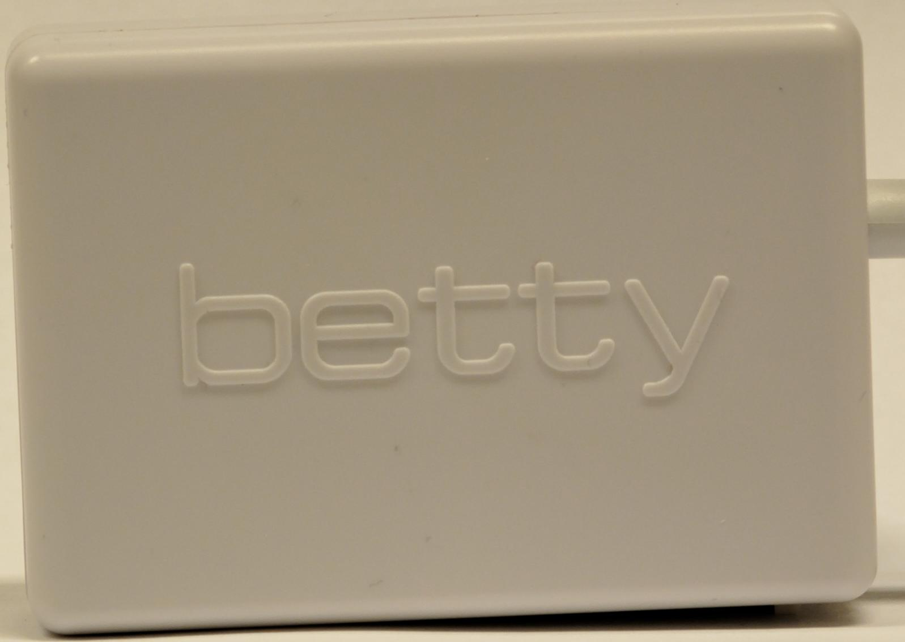
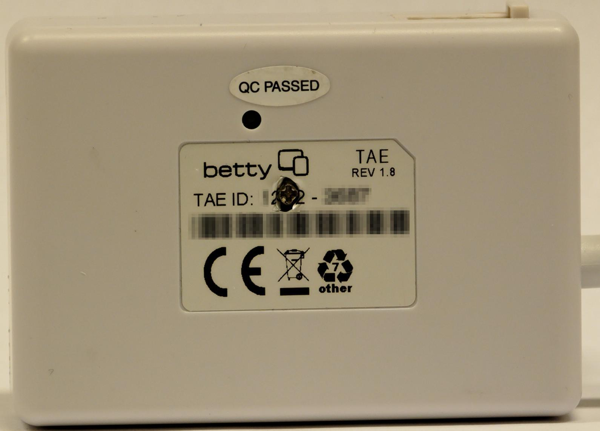
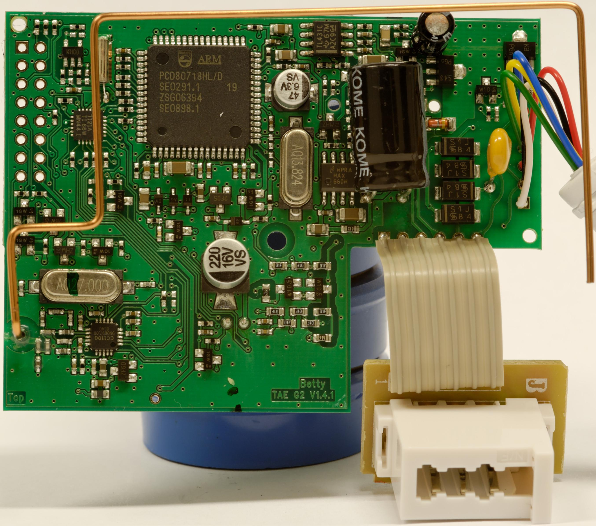
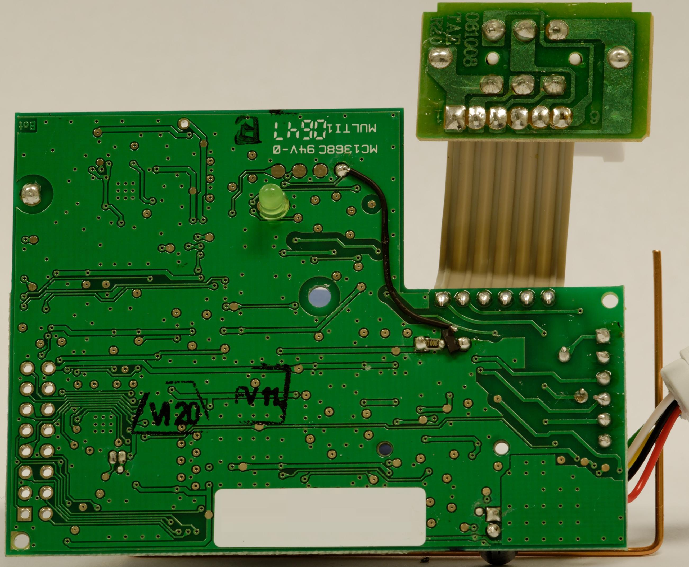

# TAE Adapter

## Funktion mit der Original-Firmware

Der TAE Adapter ermöglichte der [Betty](Betty.md "Betty") die Kommunikation mit der Zentrale der Betty TV AG.

Es wurde bei Bedarf (im Regelfall nachts) eine kostenfreie Verbindung zum Server aufgebaut, über die z.B. Spielstände gesendet und Updates empfangen werden konnten.

## Alternative Firmware

Siehe [betty_TAE](Betty%20TAE.md "Betty TAE").

## TAE Adapter öffnen

Auf der Rückseite mittig unter dem Aufkleber befindet sich eine Schraube. Sobald diese gelöst ist, können die beiden Teile einfach auseinander gezogen werden - Fingernägel oder ein Schlitzschraubendreher dürften hier hilfreich sein. Die Teile sind nur aufeinander gesteckt - es gibt keine Widerhaken, die zurückgedrückt werden müssen!

## Hardware

[TAE Adapter Hardware](TAE%20Adapter%20Hardware.md "TAE Adapter Hardware")

<!-- forum-links:start -->
## Forumsdiskussionen: PCD80718HL

Programmierung des PCD80718HL im Umfeld des TAE-Adapters.

### PCD80718HL programmieren

- [PCD80718HL programmieren](https://github.com/ghenne/betty-forum/blob/main/topics/0233-pcd80718hl-programmieren.md) — PCD80718HL programmieren.
<!-- forum-links:end -->

---

[Startseite](Main%20Page.md) · [Index](../index.md) · [Kategorien](../categories.md)

